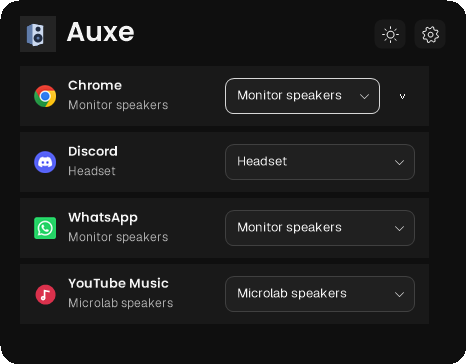
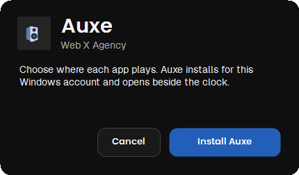
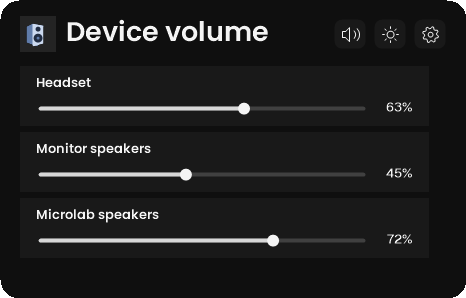
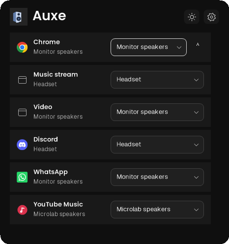

# Auxe per-app audio router for Windows 11

**Choose a different audio output for each app.** Auxe is a lightweight system tray app for Windows 11. Send Discord to your headset, Chrome to your monitor speakers, and YouTube Music to a separate device. You can also adjust the Windows volume of each connected playback device.

**[Download AuxeSetup.exe for Windows 11 x64](https://github.com/rasithsenanayake/auxe/releases/latest/download/AuxeSetup.exe)**

Visit the [Auxe website](https://rasithsenanayake.github.io/auxe/) or see the [release notes](https://github.com/rasithsenanayake/auxe/releases).

## Install Auxe

1. Run **AuxeSetup.exe**, then click **Install Auxe**.
2. Start audio in an app. Click the speaker icon near the Windows clock. If it is hidden, open the tray overflow arrow.
3. Pick an output device next to the app. Use **System default** to clear its route.

Auxe is built for Windows 11 x64. The installer is unsigned. If an older copy is running, quit it from the tray before running Setup.

## Switch audio output by app

The tray lists apps that have opened an audio session, including desktop apps such as Discord and WhatsApp. Some apps keep their existing stream on the old device after you switch outputs. If Auxe says **Restart playback to apply**, restart playback or rejoin the call. If the app has its own output setting, set it to its default so it can follow Windows routing.

## Control volume for each playback device

Click the **speaker button** at the top of Auxe to open Device Volume. Set the level for your headset, speakers, monitor, or other connected output. Each slider controls that device's Windows volume. Click the speaker again to return to app routing.

## Route Chrome tabs and YouTube Music

The optional Auxe Companion adds per-tab audio routing and can show the installed YouTube Music app separately from the browser.

1. Open `chrome://extensions` and turn on **Developer mode**.
2. Click **Load unpacked** and select `%LOCALAPPDATA%\Programs\Auxe\chrome`. If the companion is already installed, click **Reload** after updating Auxe.
3. Start playback in the tab or YouTube Music window using the same Chrome profile. Press **Ctrl+Shift+U**, then choose the output in Auxe. You can also right-click in YouTube Music and select **Toggle Auxe output for YouTube Music**.

Expand the Chrome row to see individual tabs. If the device picker only lists the default output, use **Allow device access** in the companion's options. Chrome may request microphone permission to expose playback devices. Auxe immediately stops the permission-check stream.

See Chrome tab routing

## Appearance, startup, and updates

Use the sun or moon icon to switch between dark and light appearance. Open the Settings gear to manage **Start with Windows**, automatic updates, or the Chrome companion.

Automatic updates are enabled by default. Auxe verifies the GitHub release's SHA-256 digest and applies updates while the tray panel is closed and Chrome tab routing is idle. To update manually, choose **Check for updates**, then **Install update** when one is ready.

## Privacy

Audio stays on your PC. Auxe has no account, backend, analytics, or telemetry. It does not upload audio, app names, tab titles, device names, or usage data. Windows stores routing preferences locally, and the optional Chrome companion exchanges routing information with Auxe over a local connection.

Update checks contact GitHub over HTTPS for release information and installers. GitHub receives ordinary connection information such as your IP address. Turn off automatic updates in Settings if you want offline use.

## Uninstall or build from source

- **Uninstall:** Open **Windows Settings**, then **Apps**, **Installed apps**, and **Uninstall** on the Auxe row. Remove the optional companion from Chrome separately.
- **Build:** Run `.\build.ps1` in PowerShell. It compiles the [Windows source](src/) with the .NET Framework compiler and produces `bin\Auxe.exe` and `bin\AuxeSetup.exe`. Font licenses are in [assets](assets/).

Auxe is developed by **Skipper**.
