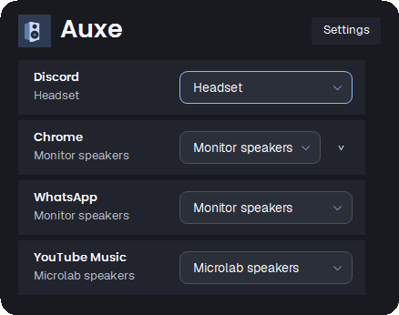
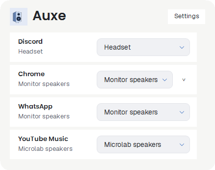
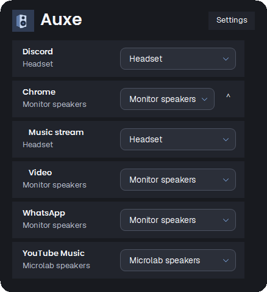
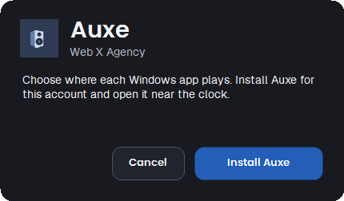
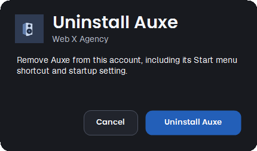

# Auxe

**Pick where each app plays.** Auxe is a lightweight Windows 11 tray app by Web X Agency. Send Discord to your headset, Chrome to your monitor, and YouTube Music to your speakers from one panel.

**[Download AuxeSetup.exe](https://github.com/rasithsenanayake/auxe/releases/latest/download/AuxeSetup.exe)**

[Download from Releases](https://github.com/rasithsenanayake/auxe/releases/latest) · [Installer in this repo](AuxeSetup.exe)

## A closer look

| Dark by default | Light appearance |
| --- | --- |
|  |  |

See individual Chrome tab outputs

Screenshots show Auxe with sample apps and devices.

## Install

1. Double-click **AuxeSetup.exe** on Windows 11 x64, then choose **Install Auxe**. The installer is also at the top level of this repo for people who clone it or download the ZIP.
2. Start playback in an app. Click the dancing speaker next to the clock or under the tray’s **^** arrow, then select an output.
3. Open **Settings** in Auxe to switch appearance, change **Start with Windows**, or manage updates.

If you already have an older build running, exit it from the tray before running Setup. The installer is unsigned.

| Install | Uninstall |
| --- | --- |
|  |  |

To remove Auxe, go to **Windows Settings → Apps → Installed apps → Auxe → Uninstall**. If you enabled the optional Chrome companion, remove it from Chrome separately.

## Audio routing

- **Windows apps.** Choose **System default** to clear a route. Auxe shows when a saved route is waiting for playback to move. Some apps need you to restart playback, rejoin the call, or select their default output in the app’s own settings.
- **Chrome tabs and YouTube Music.** In `chrome://extensions`, enable **Developer mode** and load `%LOCALAPPDATA%\Programs\Auxe\chrome` as an unpacked extension. Play audio and press **Ctrl+Shift+U** in each source you want to route. Expand the Chrome row in Auxe for individual tabs. The installed YouTube Music window appears separately when Chrome identifies it as standalone.

If Chrome only shows the default output, open the companion’s options and choose **Allow device access**. Chrome may ask for microphone permission to expose playback devices. Auxe immediately stops the permission-check stream.

## Updates

Automatic updates are on by default for installed copies. Auxe checks GitHub Releases for a newer installer, verifies its SHA-256 digest, and installs it after the tray panel is closed and Chrome tab routing is idle. In **Settings**, choose **Check for updates** to download manually, then **Install downloaded update**. You can turn automatic checks off there too. Older Auxe builds need this installer once to receive future updates.

## Privacy

**Audio stays on your PC.** Auxe has no account, backend, analytics, or telemetry. It does not collect or upload audio, app names, tab titles, device names, or usage data. Windows stores app routing preferences locally. The optional Chrome companion plays tab audio locally and passes source and device information to the tray over a local connection.

Update checks contact GitHub over HTTPS to read release metadata and download the installer. GitHub receives the usual connection information, such as your IP address. Turn off automatic updates in Auxe for offline use.

## Build from source

Run `.\build.ps1` in PowerShell. It builds `bin\Auxe.exe` and `bin\AuxeSetup.exe` using the .NET Framework compiler included with Windows. Geist and Poppins are bundled under their SIL Open Font Licenses in [assets](assets/).
